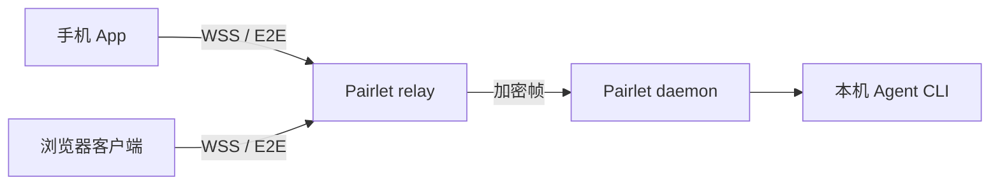

# CodeBridge Fork 开发方向

更新日期：2026-11-16。已将 `codex/swiftui-delivery` 的 SwiftUI 多 Agent 成果经备份后复制整合到 `main`，两个原工作区保持原样，并交付原生 `1.0.0 (2611151349)` 内测。观察提示、手动接管与状态更新修复及其分发状态见[当前发行说明](CODEBRIDGE-RELEASE.md)；下文 `2.0 (2026110703)` 的结果属于 2026-11-07 历史。

## 已确认的方向

以 [heypandax/pairlet](https://github.com/heypandax/pairlet) 为基础，在 [xiongYaner/pairlet](https://github.com/xiongYaner/pairlet) 二次开发。通用能力整体复用，主要投入 App 开发。此前自研的 Swift Gateway、Go Relay 与 SwiftUI App 作为旧版归档，供必要时查阅和恢复。

初始基线：`40de8b56ab8944bdcf114e772898433b5fa16721`。Pairlet 原名 CC Pocket，许可证为 [MIT](../LICENSE)。使用与分发时保留原版权与许可文本。

“全量复用”指使用上游当前保留并支持的通用能力；协议中的兼容类型不代表已下线功能仍可使用，各 Agent 的实际能力按后端分别判断。

## 模块边界

| 模块 | 本 Fork 的使用方式 |
|---|---|
| `protocol/` | 复用消息类型、能力协商、加密握手与帧格式；尽量保持上游兼容 |
| `daemon/` | 复用 Agent 适配、发现与恢复会话、审批、文件与 Diff、用量及断线恢复 |
| `relay/` | 复用配对、认证、加密帧转发和推送基础设施；运行环境另行配置 |
| `mobile/composeApp/` | 复用现有数据层、连接层和 Kotlin/Native 投影；共享能力修复尽量保持上游兼容 |
| `iosApp/` | 本 Fork 的 CodeBridge 主要产品界面与发行入口 |
| `mobile/androidApp/` | 保留上游宿主与兼容路径，不作为本轮发行目标 |

已确认使用 SwiftUI 原生客户端，以 `iosApp/codebridge.yml` 为独立工程入口，沿用旧 CodeBridge 的安装身份。通过 Kotlin/Native 的 `CodeBridgeRuntime` 复用现有数据层、加密配对和连接层，继续使用 Pairlet daemon 与 relay。首页、Agent/设备、对话、模型/思考、统计、通知、附件和常用审批界面由 SwiftUI 实现；原生化与验收进度见[实现说明](design/CODEBRIDGE-IOS-IMPLEMENTATION.md)。

持续保留 `origin` 指向本 Fork、`upstream` 指向原项目。通用模块的修复尽量保持小范围，便于跟进上游。

## 旧版归档边界

旧仓库：`xiongYaner/codex-bridge`。归档保留历史；本地另存 Git bundle、工作树源码快照、暂存与未暂存补丁、逐文件 SHA-256 清单，覆盖未提交和非忽略的新文件。具体机器路径与核验结果留在仓库外归档及任务本地记录中。

原工作目录和忽略文件保留；没有把旧版未提交改动上传到公共 Fork。2026-11-07 已将本机 daemon 和 App 默认入口切换到 `wss://relay.xiaowanai.cn`；旧 `codebridge-relay` 容器已停止但保留数据和回滚能力，`frps` 等其他服务保持运行。旧版 `bridge/v1` 与 Pairlet `pocket/*` 不是可互换协议，不能将旧客户端直接指向新中继。

## 浏览器接入可行性

结论：协议和密码原语支持浏览器实现，当前仓库没有可直接启用的 Web App。`protocol/build.gradle.kts` 当前只配置 JVM、Android 与 iOS；App 当前没有 JS/Wasm 构建目标。增加浏览器端需要客户端适配与实际互通验证。

建议浏览器作为另一个已配对设备，通过 HTTPS/WSS 连接同一套 Pairlet relay 与 daemon：

证据与需要补齐的部分：

| 环节 | 当前依据与浏览器工作 |
|---|---|
| 连接 | relay 提供 `/v1/device` WebSocket；浏览器可发送同样的文本控制帧和二进制数据帧 |
| 鉴权 | 设备凭据通过 `DeviceHello` 消息传入；沿用设备配对、吊销与重连语义 |
| 加密 | P-256 ECDH、HKDF-SHA256、AES-256-GCM 可用 Web Crypto 实现；需要与 Kotlin 的转录拼接、原始密钥编码、AAD、计数器和帧格式逐项对齐 |
| 配对 API | 浏览器受同源约束；可通过自有 Web 站点的同源反向代理调用配对接口，或配置明确的跨源许可；WebSocket 的 Origin 策略另行验证 |
| 客户端状态 | 补浏览器的设备密钥保存、凭据撤销、列表/消息流状态、重连和历史恢复；不能把 Kotlin 客户端直接当作现成 JS 包 |
| 页面生命周期 | 页面进入后台可能挂起或断开，应恢复连接并补齐状态；不能承诺后台一直在线 |
| 通知 | 浏览器前台可展示通知；后台 Web Push 需要独立适配，现有 APNs/FCM 原生推送路径不能直接等同于 Web Push |

Web 首个互通验证应依次覆盖：配对 → 设备认证 → 加密握手 → 项目/会话列表 → 流式消息 → 审批 → Diff → 断线恢复。保留端到端加密，不增加在服务端解密会话内容的 Web 专用后端。

浏览器端尚未开发，也未与真实 daemon 或生产 relay 联调；本轮只确认可行性，不把该方案记为已经交付。

## App 当前整合状态

`main` 的个人 iOS 入口为 `iosApp/codebridge.yml` 与 `iosApp/CodeBridge/`，发行脚本会校验 `CodeBridgeClient=SwiftUI`。营销版本固定 `1.0.0`，build 按北京时间 `YYMMDDHHmm` 生成。本次不包含原工作区中独立的 daemon 本地控制超时修复，也不重复部署已经完成的个人 relay 和本机 daemon。

2026-11-15 的 `2.6.1 (2026111502)` 是误发 Compose 客户端，不能作为当前安装推荐；原生低营销版本的 TestFlight 选择限制见[发行说明](CODEBRIDGE-RELEASE.md)。

## 历史交付状态（2026-11-07）

1. 已完成自有名称、Bundle ID、签名、Liquid Glass UI、Agent/设备工作区和原生对话的第一轮实现。
2. 已在新 relay 完成模拟器与真机配对、真实 Codex 回合、模型/思考/权限、统计与 APNs production 发送路径。
3. `2.0 (2026110703)` 已上传内部 TestFlight，ASC 状态为 `VALID / IN_BETA_TESTING`；外部 Beta 尚未提交审核。
4. 当时仍待验证通知点击路由、锁屏与弱网、附件/审批/Diff、语音和长时间重连；这些旧证据不能替代整合后新包的回归。
5. 官方 Codex Mac App 共用同一 app-server thread 的能力仍受上游运行端隔离限制，见[实现说明](design/CODEBRIDGE-IOS-IMPLEMENTATION.md#官方-codex-mac-app-与手机共用会话)。

## 源码依据

- [模块与平台说明](../README.zh-CN.md)
- [协议构建目标](../protocol/build.gradle.kts)
- [relay 接入](../relay/src/main/kotlin/dev/ccpocket/relay/RelayServer.kt)
- [App 的 E2E 连接](../mobile/composeApp/src/commonMain/kotlin/dev/ccpocket/app/net/RelayE2EConnection.kt)
- [密码原语](../protocol/src/commonMain/kotlin/dev/ccpocket/protocol/e2e/E2ECrypto.kt)与[握手/传输格式](../protocol/src/commonMain/kotlin/dev/ccpocket/protocol/e2e/E2ESession.kt)
- [已下线功能与限制](DECLINED-REQUIREMENTS.md)、[安全边界](SECURITY.md)
